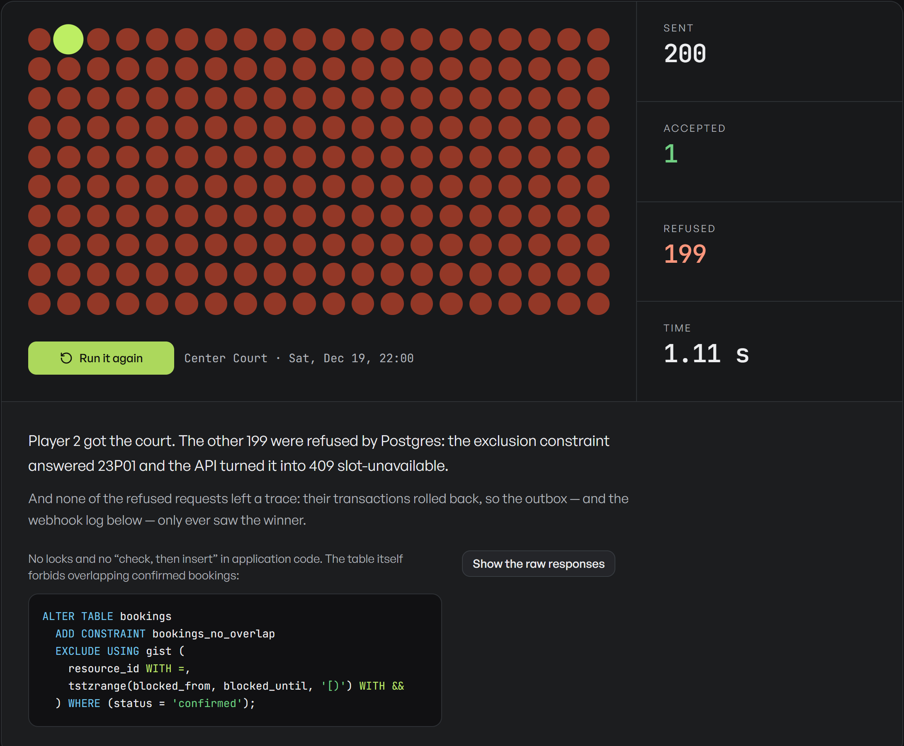
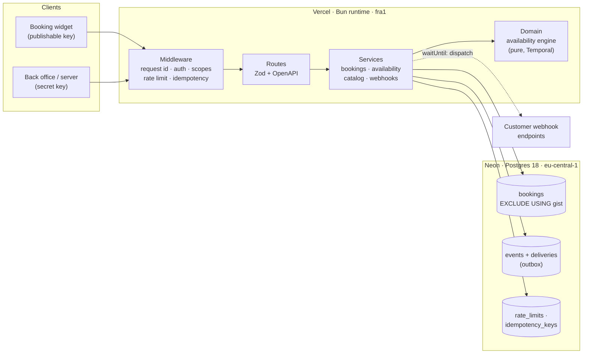
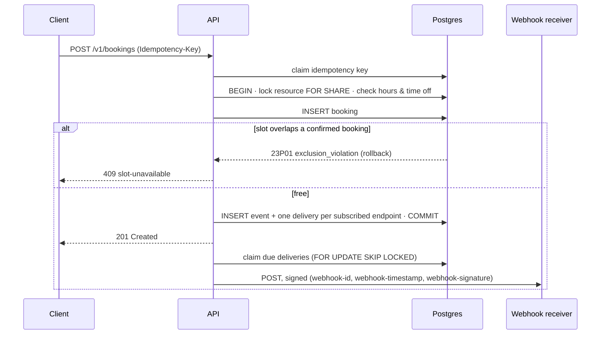

<div align="center">

# Slotlock

**A multi-tenant booking API that cannot double-book.**

Hono · Bun · TypeScript · PostgreSQL · Drizzle · Zod · Temporal

[**Live demo**](https://slotlock-ashy.vercel.app) · [API reference](https://slotlock-ashy.vercel.app/docs) · [OpenAPI 3.1](https://slotlock-ashy.vercel.app/openapi.json) · [Error catalogue](docs/errors.md)

[](https://github.com/rodrigosiboldi/slotlock/actions/workflows/ci.yml)

</div>



Open the [live demo](https://slotlock-ashy.vercel.app) and press **Start the race**: your browser fires
200 real booking requests at the same court, at the same moment. Exactly one is accepted; Postgres refuses
the other 199. Open the page in two tabs and book in one: the other updates within a second. Every
booking is delivered as a signed webhook to a receiver that verifies it, live on the same page.

## Why it cannot double-book

Most booking systems check whether a slot is free and then insert the booking. Between the check and the
insert, another request can do the same, and both succeed. Locks can close that window, but only for code
that remembers to take them.

Slotlock moves the rule into the database, where nothing can get around it:

```sql
ALTER TABLE bookings ADD CONSTRAINT bookings_no_overlap
  EXCLUDE USING gist (
    resource_id WITH =,
    tstzrange(blocked_from, blocked_until, '[)') WITH &&
  ) WHERE (status = 'confirmed');
```

Two confirmed bookings on the same resource whose blocked intervals (the booking plus the service's
buffers, such as cleaning a court) overlap cannot coexist. The application doesn't check availability
before inserting; it inserts, and turns Postgres' `23P01 exclusion_violation` into
`409 slot-unavailable`. This holds under any concurrency, on every instance of a serverless deployment,
and even for writes that never go through the API. It is tested three ways: 100 simultaneous requests
in the test suite, 200 over 20 real connections against Postgres 17 in CI, and the race in the live demo.

## What's inside

|                   |                                                                                                                                                                                                                                                                                                              |
| ----------------- | ------------------------------------------------------------------------------------------------------------------------------------------------------------------------------------------------------------------------------------------------------------------------------------------------------------ |
| **Availability**  | Weekly opening hours in each resource's IANA time zone, time off, buffers, a slot grid, minimum notice and a booking window. Computed with the [Temporal API](https://tc39.es/proposal-temporal/docs/): on the night clocks go back, 02:30 happens twice and both slots are offered, with different offsets. |
| **Bookings**      | Book a resource or let the API pick the first free one; cancel; reschedule atomically. Customer rules (grid, notice, window) apply to publishable keys; staff with secret keys can book any open time.                                                                                                       |
| **Multi-tenancy** | Organizations with **secret** keys (servers) and **publishable** keys (public booking widgets), scoped per key and stored as SHA-256 hashes.                                                                                                                                                                 |
| **Safe retries**  | `Idempotency-Key` on every POST: the same key returns the stored response for 24 h; the same key with a different body is refused.                                                                                                                                                                           |
| **Webhooks**      | Transactional outbox, [Standard Webhooks](https://www.standardwebhooks.com) signatures, retries with backoff (30 s, 2 min, 10 min, 1 h, 6 h), dispatchers coordinated with `FOR UPDATE SKIP LOCKED`, secrets encrypted with AES-256-GCM, SSRF protection at registration and at every delivery.              |
| **Real time**     | `GET /v1/availability/stream`: Server-Sent Events whenever availability changes, fed from the same outbox.                                                                                                                                                                                                   |
| **Rate limits**   | A sliding-window counter in Postgres, updated in one statement, shared by every instance. `RateLimit-*` headers on every response.                                                                                                                                                                           |
| **Errors**        | [RFC 9457](https://www.rfc-editor.org/rfc/rfc9457) problem details with stable, [documented types](docs/errors.md) and a request id.                                                                                                                                                                         |
| **Documentation** | Zod schemas drive validation, TypeScript types and the OpenAPI 3.1 document; the [Scalar reference](https://slotlock-ashy.vercel.app/docs) is generated, never hand-written.                                                                                                                                 |
| **Operations**    | Structured JSON logs with request ids, Prometheus metrics, liveness and readiness (which checks the constraint exists), a daily cron, graceful shutdown.                                                                                                                                                     |

## Architecture



The domain layer is pure (no clock, no I/O); services own transactions; routes only translate HTTP.
Dependencies (database, clock, outbound `fetch`, background scheduler) are injected, so the same app runs
on Vercel (with `waitUntil`), as a standalone Bun server (with an in-process dispatcher and graceful
shutdown) and in tests (PGlite, a controllable clock, a recording `fetch`).

### One booking, end to end



## A quick tour

```bash
export SLOTLOCK=https://slotlock-ashy.vercel.app
export KEY=$(curl -s $SLOTLOCK/demo/config | jq -r .publishableKey)   # the demo club's widget key
export SERVICE=$(curl -s $SLOTLOCK/demo/config | jq -r .matchServiceId)

# Open slots for a 90-minute match, across the club's four courts
curl -s "$SLOTLOCK/v1/availability?serviceId=$SERVICE&from=$(date -d '+2 days' +%F)" \
  -H "Authorization: Bearer $KEY" | jq '.slots[:3]'

# Book one (copy a resourceId and start from above). Repeat it with a new key: 409.
curl -s -X POST "$SLOTLOCK/v1/bookings" -H "Authorization: Bearer $KEY" \
  -H "Content-Type: application/json" -H "Idempotency-Key: $(uuidgen)" \
  -d '{"serviceId":"'$SERVICE'","resourceId":"…","startsAt":"…","customer":{"name":"Ada","email":"ada@example.com"}}'
```

The [reference](https://slotlock-ashy.vercel.app/docs) lists every endpoint with examples and lets you
send requests from the browser.

| Area              | Endpoints                                                                                                                                  |
| ----------------- | ------------------------------------------------------------------------------------------------------------------------------------------ |
| Availability      | `GET /v1/availability` · `GET /v1/availability/stream` (SSE)                                                                               |
| Bookings          | `POST /v1/bookings` · `GET /v1/bookings` · `GET /v1/bookings/{id}` · `POST /v1/bookings/{id}/cancel` · `POST /v1/bookings/{id}/reschedule` |
| Catalogue         | `/v1/resources` (+ `/{id}`, `/{id}/time-off`) · `/v1/services` (+ `/{id}`)                                                                 |
| Webhooks & events | `/v1/webhook-endpoints` (+ `/{id}/deliveries`) · `GET /v1/events`                                                                          |
| System            | `GET /healthz` · `GET /readyz` · `GET /metrics` · `GET /openapi.json` · `GET /docs`                                                        |

## Running it

Requirements: [Bun](https://bun.sh) 1.4+ and Postgres 15+ with `btree_gist` (any managed Postgres has it).

```bash
bun install
cp .env.example .env            # point DATABASE_URL at your Postgres
bun run db:migrate
bun run build                   # the demo page (React + shadcn/ui + Tailwind)
bun run dev                     # http://localhost:3000
```

Or everything in containers: `docker compose up --build`.

## Tests

```bash
bun test                                       # the whole suite, on PGlite (real Postgres in WASM)
TEST_DATABASE_URL=postgres://… bun test        # adds the real-server concurrency test
bun run verify                                 # typecheck + lint + tests
bun run smoke https://slotlock-ashy.vercel.app # end-to-end check of a deployment
```

- **Unit:** the availability engine, including both daylight-saving transitions, windows that cross
  midnight, buffers, notice, booking windows and customer versus staff rules.
- **Integration:** the real app on a real Postgres engine ([PGlite](https://pglite.dev), in-process,
  with the real migrations): 100 simultaneous bookings for one slot, buffers, idempotent replays and
  key reuse, rate limits sliding over time, scopes, tenant isolation, cursor pagination, time off,
  webhook signatures, retries until they give up, the outbox staying empty for rolled-back bookings,
  and SSRF rules.
- **Real Postgres:** 200 requests over 20 connections against Postgres 17 in CI.

## Deployment

The live demo runs on **Vercel Functions with the Bun runtime** in Frankfurt, next to a **Neon**
Postgres in the same region. Webhook dispatch runs after the response with `waitUntil`; a daily Vercel
Cron expires idempotency keys and limiter rows, sweeps webhook retries and resets the demo club. The
same code also ships as a container (`Dockerfile`) that runs `Bun.serve` with a 5-second dispatcher
and graceful shutdown.

## Design decisions

- **The database owns the invariant.** Correctness doesn't depend on every code path remembering a lock.
  Application checks (opening hours, notice) produce good error messages; the constraint makes the
  guarantee.
- **Share locks, not exclusive ones.** Bookings take `FOR SHARE` on the resource, so they don't serialize
  each other (the constraint arbitrates between them), while adding time off takes `FOR UPDATE` and can't
  slip in between a booking's check and its insert.
- **One clock.** Timestamps the dispatcher compares (`next_attempt_at`) come from the application clock,
  never mixed with the database's `now()`, so clock skew can't delay deliveries — and tests can travel in
  time.
- **No Redis.** Rate limits and idempotency live in Postgres: one less moving part, shared by every
  serverless instance, transactional when it matters.
- **Polling the outbox for SSE.** Postgres `LISTEN/NOTIFY` doesn't work through Neon's pooler; reading
  new events by UUIDv7 cursor works everywhere and keeps the booking path unaware of listeners.

## Limits

- On serverless, due webhook retries are swept after every booking change and by the daily cron; the
  container runs the dispatcher every 5 s. For a tight retry schedule on serverless, a queue (Vercel
  Queues, QStash) would take over that job.
- Metrics are per instance on serverless; scrape the container for fleet-wide numbers.
- Resources hold one booking at a time; capacity (a class with 12 places) would need a different
  constraint or a counter row.

## En español

Slotlock es una API de reservas multiempresa en **Hono + Bun + TypeScript + PostgreSQL** que no puede
reservar dos veces el mismo turno: lo garantiza una restricción de exclusión en Postgres, no el código de
la aplicación. Incluye disponibilidad con zonas horarias y cambios de hora (API Temporal), claves de API
por empresa con permisos, idempotencia al estilo Stripe, webhooks firmados con outbox transaccional y
reintentos, límites de pedidos compartidos entre instancias, errores RFC 9457, documentación OpenAPI 3.1
generada desde el código, tests sobre Postgres real y deploy en Vercel con Neon. En la
[demo en vivo](https://slotlock-ashy.vercel.app) puedes lanzar 200 reservas simultáneas al mismo turno y ver
que entra exactamente una.

---

Built by [Rodrigo Siboldi](https://rodrigosiboldi.com) · MIT License
